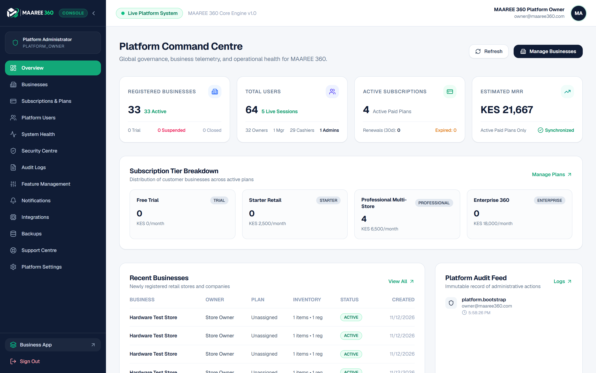
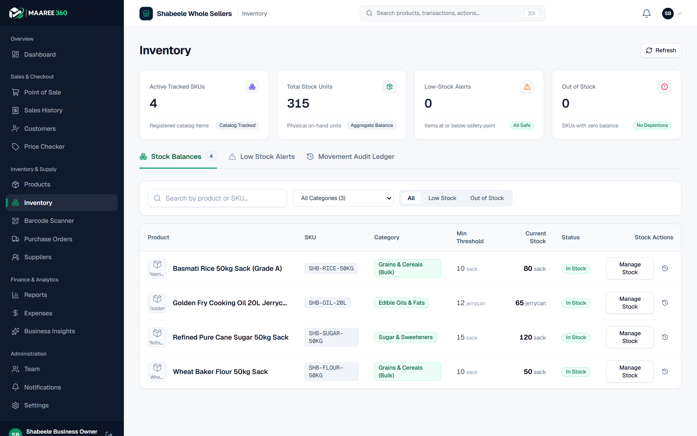
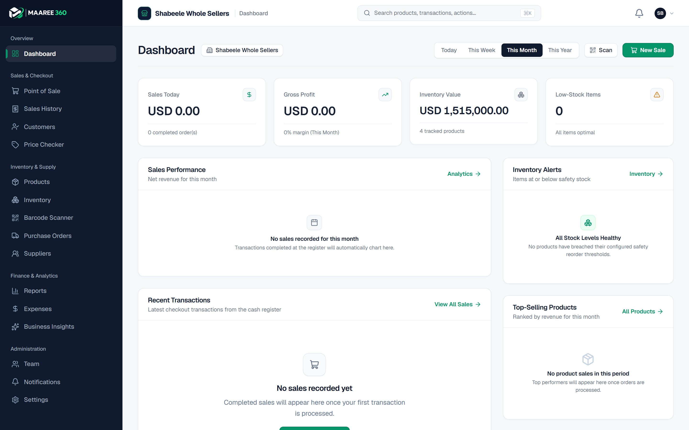
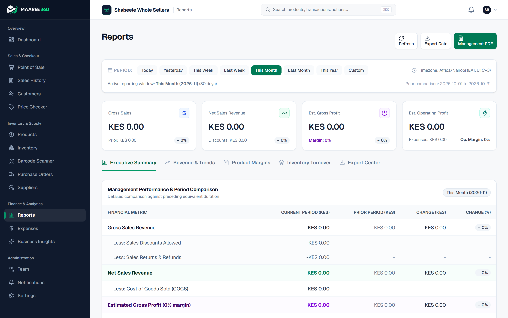
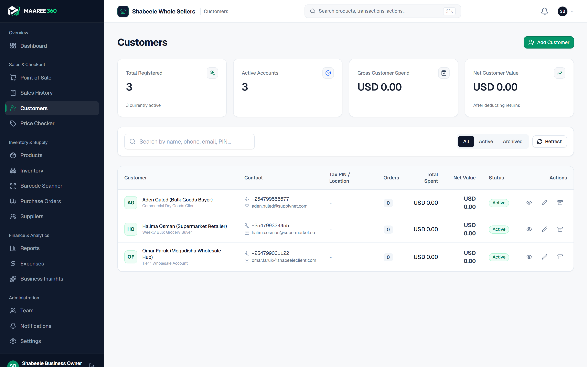
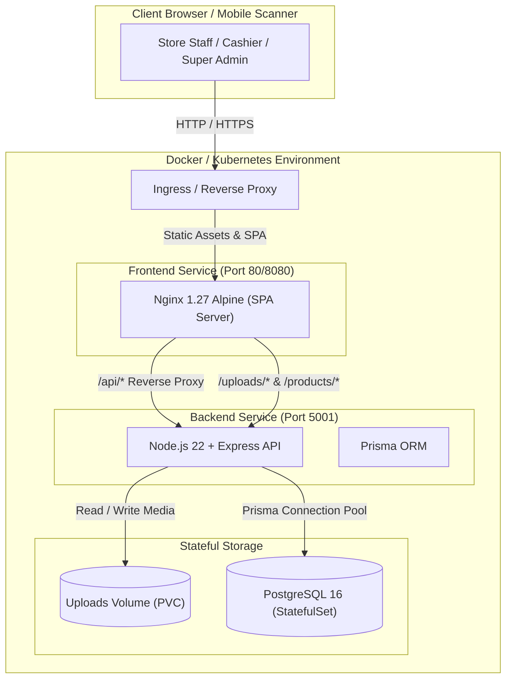
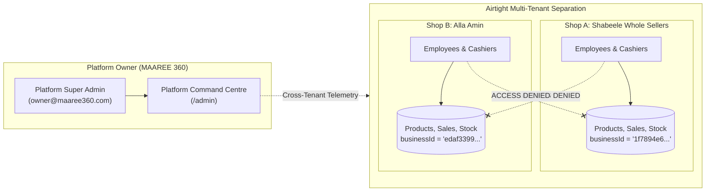

# MAAREE 360 — Enterprise Retail Management Platform

> **Sell Smarter. Manage Better. Scale Effortlessly.**  
> A professional, cloud-native multi-tenant Point of Sale (POS), real-time inventory control, and retail business intelligence platform engineered for multi-branch retail operations, supermarkets, wholesale distributors, and retail businesses across Kenya and East Africa.

[](https://www.typescriptlang.org/)
[](https://react.dev/)
[](https://nodejs.org/)
[](https://www.postgresql.org/)
[](https://www.prisma.io/)
[](https://www.docker.com/)
[](https://kubernetes.io/)
[](https://github.com/features/actions)
[-emerald.svg)](#currency--localization)

---

## Table of Contents

1. [Executive Overview](#executive-overview)
2. [Current Application Visual Tour](#current-application-visual-tour)
3. [System Architecture](#system-architecture)
4. [Containerization & Docker Quickstart](#containerization--docker-quickstart)
5. [Kubernetes Orchestration & Minikube](#kubernetes-orchestration--minikube)
6. [CI/CD Pipelines & GitHub Actions](#cicd-pipelines--github-actions)
7. [Multi-Tenant Data Isolation & Security](#multi-tenant-data-isolation--security)
8. [Platform Administration vs Business Administration](#platform-administration-vs-business-administration)
9. [Default Test Accounts & Credentials](#default-test-accounts--credentials)
10. [Configuration & Environment Variables](#configuration--environment-variables)
11. [Repository & Release Management](#repository--release-management)
12. [License](#license)

---

## Executive Overview

**MAAREE 360** is a production-grade, enterprise retail operating system designed for modern multi-store commerce. It bridges the gap between hardware POS terminals and cloud business intelligence with two distinct management planes:

1. **Platform Administration Console (`/admin`)**: A centralized telemetry and governance hub for the SaaS platform owner to monitor registered customer shops, manage subscription tiers, audit platform security, track MRR, and review system health.
2. **Business Administration & POS (`/dashboard`, `/pos`, etc.)**: An isolated operational environment for individual retail businesses (e.g. Shabeele Whole Sellers, Alla Amin, Khalil Academy, Raqiis Electronics) to manage employees, catalogue items, barcodes, suppliers, purchase orders, customer credits, and cash registers.

---

## Current Application Visual Tour

The following production screenshots capture the latest user interface design, business identity header switcher, and platform administration console running with authentic business data:

### 1. Business Executive Dashboard
*Real-time sales revenue, estimated gross profit margins, inventory valuation, recent transaction feeds, and business identity badge in the global navigation header.*


### 2. Platform Command Centre (Super Admin Console)
*Dedicated SaaS platform owner environment monitoring registered businesses, live user sessions, subscription plan distribution, and platform audit logs.*


### 3. High-Speed Point of Sale (POS) Terminal
*Dual-pane cashier interface supporting USB/Bluetooth physical barcode guns, WebRTC camera scanning, category chips, active order basket, and keyboard hotkeys (F12).*


### 4. Retail Products & Packshot Photography
*Comprehensive SKU catalogue featuring real supermarket and wholesale goods, margin calculations, unit descriptors, and active stock levels.*


### 5. Strict Non-Negative Inventory Ledger
*Double-entry stock movement tracking recording receipts, adjustments, damages, and POS deductions with automated safety threshold warnings.*


### 6. Sales Transactions & Audit History
*Chronological register records detailing tender types (Cash, M-Pesa, Card), cashier identifiers, and itemized customer receipts.*


### 7. Financial Intelligence & P&L Reports
*Comprehensive profit & loss summaries, gross margin tracking, operating expense categorization, and exportable business statements.*


### 8. Customer Accounts & Credit Ledger
*Customer profiles tracking purchase history, tax PINs, contact information, and store return balances.*


---

## System Architecture

### 1. Cloud-Native Container Architecture



### 2. Multi-Tenant Isolation Architecture



---

## Containerization & Docker Quickstart

MAAREE 360 is fully containerized using multi-stage, secure Dockerfiles and orchestrated via Docker Compose.

### Prerequisites

- [Docker Engine](https://docs.docker.com/engine/) (v24+)
- [Docker Compose](https://docs.docker.com/compose/) (v2.20+)

### Launching the Stack

To build and start the entire stack (Database, Backend API, and Frontend Nginx) with automatic data restoration:

```bash
# Clone the repository
git clone https://github.com/your-org/maaree360.git
cd maaree360

# Start all services in the background
docker compose up -d
```

### Verified Service Ports

| Service | Container Port | Published Host Port | Purpose | Health Check |
|---|---|---|---|---|
| `smartstock_frontend` | 80 | **8080** | React SPA + Nginx Reverse Proxy | `http://localhost:8080/healthz` |
| `smartstock_backend` | 5001 | **5001** | Node.js Express REST API | `http://localhost:5001/api/v1/health` |
| `smartstock_db` | 5432 | **5433** | PostgreSQL 16 Database | `pg_isready -U postgres -d smartstock_db` |

> [!NOTE]
> The database host port is published on `5433` by default to avoid conflicts with any local PostgreSQL instance installed on the host machine.

### Checking Container Health

```bash
docker compose ps
```

### Stopping the Stack

```bash
# Stop containers while preserving database volume
docker compose down

# Stop containers and remove volumes (clean wipe)
docker compose down -v
```

---

## Kubernetes Orchestration & Minikube

All production Kubernetes manifests are organized cleanly inside the [`k8s/`](file:///e:/SmartStock/k8s) directory and support declarative deployment via Kustomize.

### Manifest Structure

```
k8s/
├── 00-namespace.yaml             # Dedicated 'smartstock' namespace
├── 01-configmap.yaml             # Application configuration & URLs
├── 02-secrets.yaml               # Database credentials & session keys
├── 03-pvc.yaml                   # Persistent storage for uploads
├── 04-postgres-statefulset.yaml  # PostgreSQL 16 StatefulSet & headless service
├── 05-backend-deployment.yaml   # Express API Deployment (2 replicas, probes)
├── 06-frontend-deployment.yaml  # Nginx Frontend Deployment (2 replicas, NodePort)
├── 07-ingress.yaml              # Ingress routing for smartstock.local
└── kustomization.yaml           # Single-command bundle configuration
```

### Deploying to Minikube

```bash
# 1. Start your Minikube cluster
minikube start

# 2. Build or load the container images into Minikube
minikube image load smartstock-db:latest
minikube image load smartstock-backend:latest
minikube image load smartstock-frontend:latest

# 3. Deploy the entire stack with Kustomize
kubectl apply -k k8s/

# 4. Monitor rollout status
kubectl get pods -n smartstock -w
```

### Accessing the Application in Minikube

```bash
# Retrieve the auto-allocated NodePort service URL
minikube service smartstock-frontend -n smartstock --url
```

---

## CI/CD Pipelines & GitHub Actions

Automated Continuous Integration and Continuous Delivery workflows are located in [`.github/workflows/`](file:///e:/SmartStock/.github/workflows):

### 1. Continuous Integration (`ci.yml`)

Triggers on every `push` and `pull_request` targeting `main` or `master`:
- **Code Quality & Type Checks:** Runs `tsc --noEmit` across both `client/` and `server/`.
- **Backend Integration Tests:** Spins up an ephemeral `postgres:16-alpine` service container, applies Prisma migrations, and executes the complete 310-test Vitest suite.
- **Infrastructure Validation:** Runs `docker compose config --quiet` and validates all Kubernetes manifests using `kubectl apply --dry-run=client -k k8s/`.
- **Production Bundling:** Compiles client Vite distribution and server TypeScript dist.

### 2. Continuous Delivery (`cd.yml`)

Triggers on semantic git release tags (`v*.*.*`) or manual dispatch:
- Builds multi-stage production Docker images using Docker Buildx and GitHub Actions layer cache.
- Publishes images to **GitHub Container Registry (GHCR)**:
  - `ghcr.io/<owner>/smartstock-frontend`
  - `ghcr.io/<owner>/smartstock-backend`
  - `ghcr.io/<owner>/smartstock-db`
- Performs automated container vulnerability scanning with **Trivy**.

---

## Multi-Tenant Data Isolation & Security

Every transactional entity in MAAREE 360 is strictly scoped to a `businessId` foreign key with composite database indices and server-side middleware verification:

1. **Scoped Database Queries:** Every select, insert, update, and delete operation includes an explicit `where: { businessId }` clause.
2. **Session Verification:** The authenticated user's session stores their active business context. Access to unauthorized businesses returns `403 Forbidden`.
3. **Double-Entry Stock Ledger:** Inventory adjustments, sales, and requisitions require an immutable movement record; negative stock balances are rejected at the database level.
4. **Security Headers:** HTTP responses enforce strict CSP, HSTS, X-Content-Type-Options: nosniff, X-Frame-Options: SAMEORIGIN, and CSRF token verification.

---

## Default Test Accounts & Credentials

The pre-seeded database contains authentic Kenyan retail businesses ready for testing:

### Platform Super Administrator (Platform Owner)

| Role | Email | Password | Access Scope |
|---|---|---|---|
| **Platform Owner** | `owner@maaree360.com` | `Maaree360@Admin2026!` | Full Platform Command Centre (`/admin`) |

### Business Tenant Accounts (Shabeele Whole Sellers)

| Role | Email | Password | Access Scope |
|---|---|---|---|
| **Store Owner** | `owner@shabeele.com` | `Shabeele@2026!` | Shabeele Whole Sellers & Branch |
| **Branch Manager** | `manager@shabeele.com` | `Shabeele@2026!` | Store Management & Stock Requisition |
| **Cashier** | `cashier@shabeele.com` | `Shabeele@2026!` | POS Terminal & Register Checkout |

---

## Configuration & Environment Variables

A template configuration file is provided in [`.env.example`](file:///e:/SmartStock/.env.example):

```env
# Server Runtime
NODE_ENV=production
PORT=5001
FRONTEND_PORT=8080
BACKEND_PORT=5001
FRONTEND_URL=http://localhost:8080

# PostgreSQL 16 Database
POSTGRES_USER=postgres
POSTGRES_PASSWORD=postgres
POSTGRES_DB=smartstock_db
POSTGRES_PORT=5433
DATABASE_URL=postgresql://postgres:postgres@db:5432/smartstock_db?schema=public

# Localization & Currency
DEFAULT_CURRENCY=KES

# Session & Authentication
SESSION_SECRET=smartstock-production-super-secret-key-32chars
COOKIE_NAME=smartstock_session
SESSION_TTL_DAYS=7

# Media Directories
PRODUCTS_DIR=/app/products
UPLOAD_DIR=/app/uploads
```

---

## Repository & Release Management

### Git Workflow & Branch Protections

- `main`: Protected branch. Direct pushes are disabled; all changes require an approved Pull Request and green CI status.
- `feat/*`: Feature branches for new functionality.
- `fix/*`: Bug fix branches.
- `chore/*` / `infra/*`: DevOps and infrastructure maintenance.

### Conventional Commits & Versioning

Follow the [Conventional Commits](https://www.conventionalcommits.org/) specification:
- `feat(pos)`: Add barcode gun timeout guard
- `fix(tenant)`: Enforce business boundary on customer credit balances
- `infra(k8s)`: Add readiness and liveness probes to backend deployment

---

## License

Proprietary — All rights reserved © MAAREE 360.
